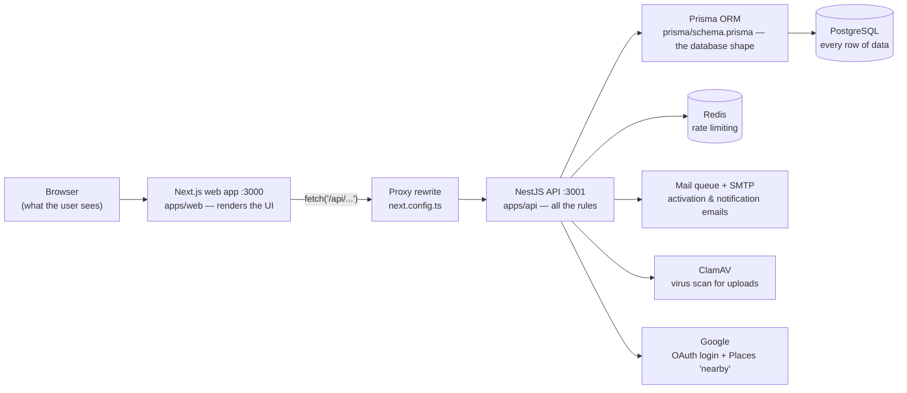
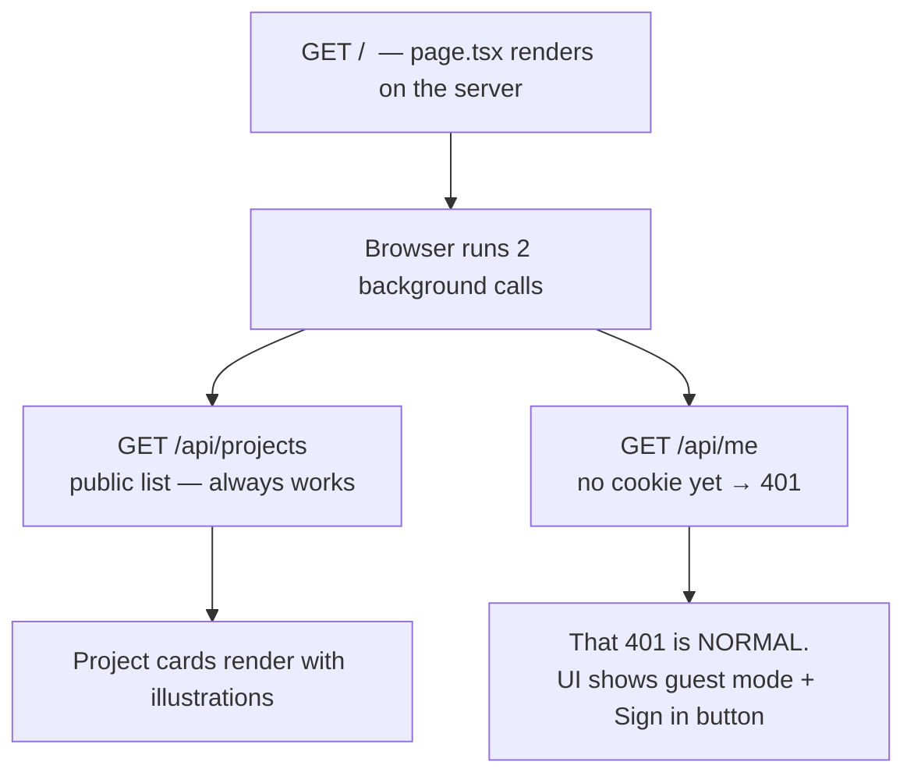
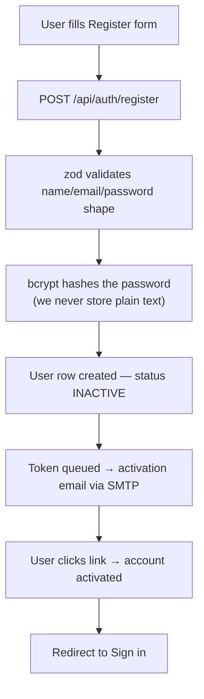
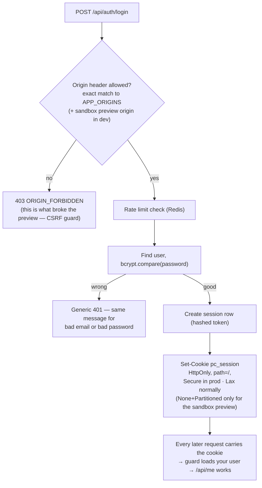
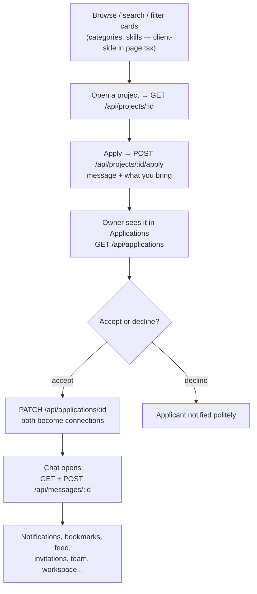
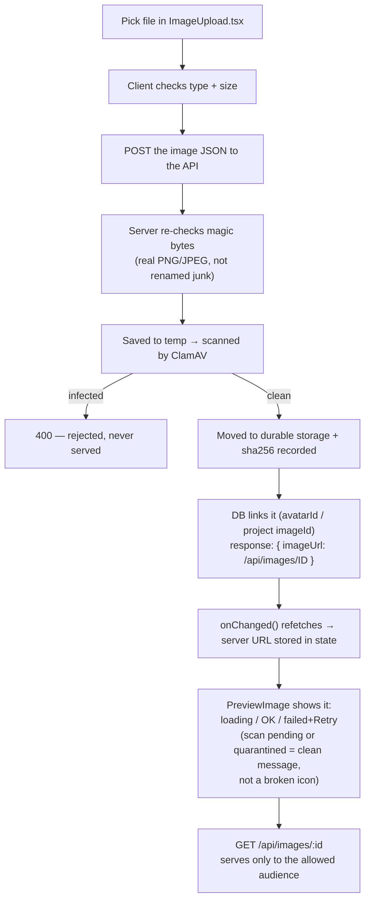
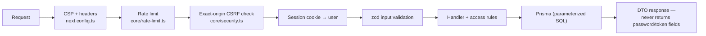
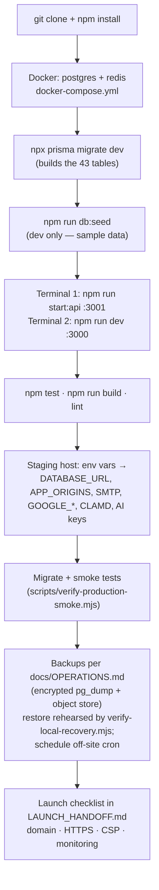

# ProjectConnect — End-to-End Flow, for a Beginner Developer

> Every box below is a real step in *this* codebase, with the file to open.
> Read top to bottom. Jargon is explained in the glossary at the end.

---

## 0. The big picture

**One sentence:** the browser never talks to the database. It talks to Next.js,
Next.js forwards `/api/*` to NestJS, NestJS checks rules, then Prisma reads/writes Postgres.

---

## 1. A visitor arrives (no login yet)

File: `apps/web/app/page.tsx` (the whole home UI), `apps/api/src/main.ts` (`@Get("projects")`, `@Get("me")`).

---

## 2. Creating an account

Dev data only: `prisma/seed.ts` creates sample profiles for manual sign-in while developing; seeding is blocked in production.

Files: `apps/api/src/main.ts` (register/login), `apps/api/src/core/security.ts` (validation + session helpers), `apps/api/src/core/mail.ts` (queue), `prisma/seed.ts`.

---

## 3. Login → session cookie (the heart of the app)

Files: `apps/api/src/core/security.ts` (origins, cookie options), `apps/api/src/core/preview-config.ts` (sandbox-only cookie mode), `apps/api/src/core/rate-limit.ts`.

Google login: `apps/api/src/features/oauth.ts` — `/api/auth/google/start` → Google → `/api/auth/google/callback` → find-or-create user → same cookie.

---

## 4. The core product loop

Files: `apps/api/src/main.ts` (projects/applications/messages), `apps/api/src/features/social.ts`, `Invitations.tsx`, `apps/web/app/components/Workspace.tsx`.

---

## 5. Uploading an image (avatar or project photo) — why it can look "broken"

Files: `apps/web/app/components/ImageUpload.tsx`, `apps/web/app/components/PreviewImage.tsx`, `apps/api/src/features/images.ts`, `apps/api/src/core/file-scanner.ts`, `apps/api/src/core/storage-scan.ts`.

Key idea for beginners: **the thumbnail you pick is not stored.** What you see after saving comes back from the server — so if the server can't reach you (blocked cookie, wrong origin, scan pending), the right behavior is a visible failure + retry, which is exactly what PreviewImage does.

---

## 6. Extras (same pattern as above: UI → /api route → guard → Prisma)

| Feature | Front end | Back end |
|---|---|---|
| Find people nearby | `NearbyHardware.tsx`, `GoogleStoreSearch.tsx` | `features/places.ts` + `core/places.ts` (server key, distance filter, attribution) |
| AI assistant | `AiAssistant.tsx` | `features/assistant.ts`, `core/ai-budget.ts` + `core/ai-ledger.ts` (per-user daily budget) |
| Moderation (admin) | `AdminPanel.tsx` | `features/moderation.ts` |
| Export my data / delete account | `AccountExport.tsx` | `features/export.ts`, `features/account.ts` (`@Get("export")`, `@Delete()`) |
| Account settings, sessions | `apps/web/app/account` | `features/account.ts` (`@Get("sessions")`, `@Post("reset-password")`…) |

---

## 7. Every request passes the same gauntlet

---

## 8. Running & shipping it yourself

---

## Glossary (5 words that unlock the rest)

- **API** — the back-end program that owns all the rules; here it's NestJS on port 3001.
- **Session cookie** — a small signed note your browser keeps after login, proving who you are on every request.
- **ORM / Prisma** — typesafe database access; no hand-written SQL strings; `schema.prisma` is the single source of truth.
- **Migration** — a numbered, replayable file that changes the database shape (add a column, add a table).
- **CSRF / origin check** — the server refuses writes that didn't come from an approved site origin; this is why preview domains must be allow-listed exactly.

## Where things live

| You want to change… | Open |
|---|---|
| Home UI, cards, modals | `apps/web/app/page.tsx` |
| Shared components (upload, chat, admin…) | `apps/web/app/components/` |
| Look & feel | `apps/web/app/globals.css` + `design-refresh.css` |
| Auth, projects, apply, chat routes | `apps/api/src/main.ts` |
| Accounts, images, places, AI, export | `apps/api/src/features/*.ts` |
| Security (cookies, origins, validation) | `apps/api/src/core/security.ts` |
| Database shape | `prisma/schema.prisma` + `prisma/migrations/` |
| Demo/seed data | `prisma/seed.ts` |
